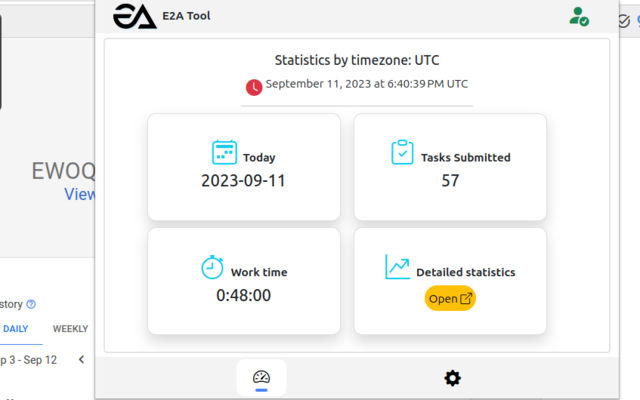
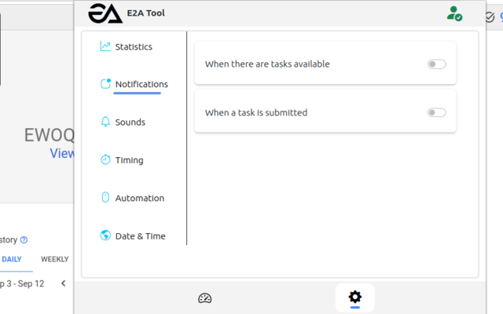
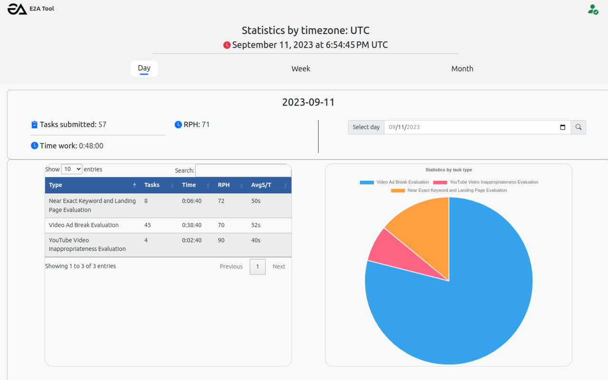
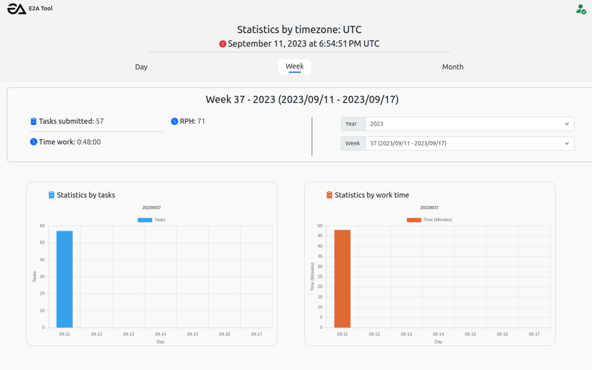
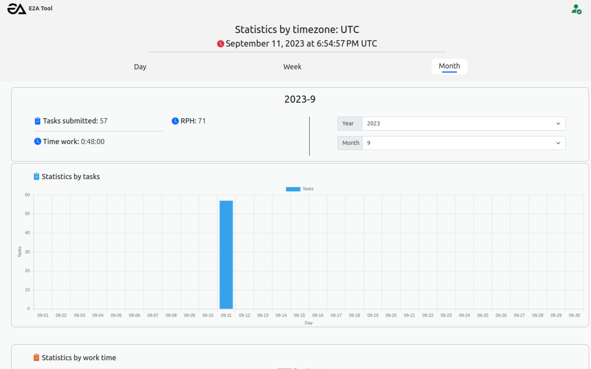

# E2A Tool – EWOQ Time Tracker & Productivity Analytics

A Chrome extension designed to help EWOQ Rating Portal workers track task activity, analyze productivity, and automate repetitive workflows.

**[Chrome Web Store](https://chromewebstore.google.com/detail/cldfkemddbcgefbbonppjlnjfjdojlae)** | **[Privacy Policy](PRIVACY.md)**

## Overview

E2A Tool is an independently developed browser extension for task tracking and productivity management on the EWOQ Rating Portal.

The project was created to address practical challenges such as manually tracking working time, counting completed tasks, monitoring task availability, and evaluating productivity across different task categories.

E2A Tool was published on the Chrome Web Store and developed through multiple iterations, from feature implementation to codebase restructuring.

## Key Features

### Task Tracking
- Track completed tasks and working time.
- Monitor task duration during active work sessions.
- Calculate productivity metrics, including RPH (tasks per hour) and average time per task.

### Productivity Analytics
- View statistics by day, week, and month.
- Analyze performance across task categories.
- Visualize task distribution and working time using charts.
- Support timezone-based statistics and reporting.

### Notifications & Automation
- Notify users when tasks become available.
- Provide task submission notifications and configurable sounds.
- Automatically reload the portal when no tasks are available.
- Support automated task submission.
- Customize timing and automation settings.

### User Preferences
- Configure notification, sound, timing, and automation behavior.
- Store task records and user preferences locally in the browser.
- Verify extension access through a developer-operated authentication service.

## Tech Stack

| Category | Technologies |
|---|---|
| Language | JavaScript |
| Platform | Chrome Extension Manifest V3 |
| Background Processing | Service Worker, ES Modules |
| Browser Integration | Content Scripts, Chrome Extension APIs |
| Frontend | HTML, CSS, JavaScript |
| Data Visualization | Chart.js |
| Data Storage | Chrome Local Storage |
| Authentication | Developer-operated verification API (legacy) |

## Project Architecture

The extension separates browser-page integration, background processing, and user interfaces into distinct modules.

```text
e2a-tool-extension/
├── assets/          # Images, icons, and notification sounds
├── background/      # Service Worker, storage, permissions, UI logic
├── content/         # EWOQ page integration and observation
├── data/            # Default settings and configuration data
├── libs/            # Third-party frontend libraries
├── pages/           # Popup, statistics dashboard, error pages
├── style/           # Page-specific stylesheets
├── utils/           # Shared messaging utilities
└── manifest.json    # Chrome Extension Manifest V3
```

**Main components:**

- **Content Scripts:** Observe and interact with the EWOQ Rating Portal.
- **Background Service Worker:** Coordinates extension events and browser functionality.
- **Popup Interface:** Displays task summaries and provides configuration controls.
- **Statistics Dashboard:** Presents historical task data, productivity metrics, and visualizations.
- **Local Storage:** Persists task records and user preferences within the browser.

## Screenshots

The following screenshots are from the Chrome Web Store release (v2.1.1) and demonstrate the project's core functionality.

### Extension Dashboard


### Settings & Notifications


### Daily Productivity Analytics


### Weekly Productivity Analytics


### Monthly Productivity Analytics


## Development & Version History

**Version 2.x — Core Product Development**

Implemented the primary task tracking, productivity analytics, notifications, and workflow automation features. Version 2.1.1 was published on the Chrome Web Store.

**Version 3.x — Codebase Refactoring**

Focused primarily on reorganizing and refactoring the extension's source code, improving modularity and maintainability while retaining the established core functionality.

The source code in this repository represents **v3.2.0**, while the Chrome Web Store release represents **v2.1.1**.

## Project Status

This repository is maintained as a software engineering portfolio project showcasing browser extension development, event-driven processing, productivity analytics, and workflow automation.

The legacy authentication backend is no longer operational. Consequently, the published extension may not be fully functional without changes to its authentication mechanism.

The authentication backend source code is not included in this repository.

## Disclaimer

E2A Tool is an independent project and is not affiliated with or endorsed by Google, Appen, TELUS, or the operators of the EWOQ Rating Portal.